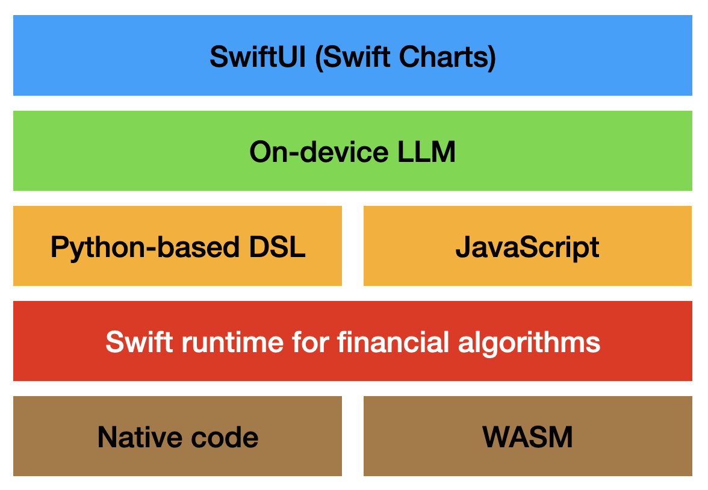

# swifttrade
**Trading in Swift**

We'll soon release the first public beta version (via TestFlight). If interested, get in touch to obtain an account.

For experiments with tools for Apple's on-device LLMs, check out [this app](https://apps.apple.com/us/app/aiscript/id6755296055).

For more information on the AI used here follow [this Quantal repo](https://github.com/phomola/quantal).

**Update**: Apple Intelligence (especially Private Cloud Compute) is a game changer. It allowed us to implement our agent quickly, improve actor-based concurrency and integrate the app with Siri. The first demo version can be found [here](https://github.com/phomola/quantal/blob/dmg-alpha/Quantal.dmg).

A public beta version will be available in September 2026 for macOS/iOS 27.

Update: We've recently joined a big crypto exchange so any code written in the past weeks will remain closed-source for obvious reasons. A huge thank you to our beta testers!
